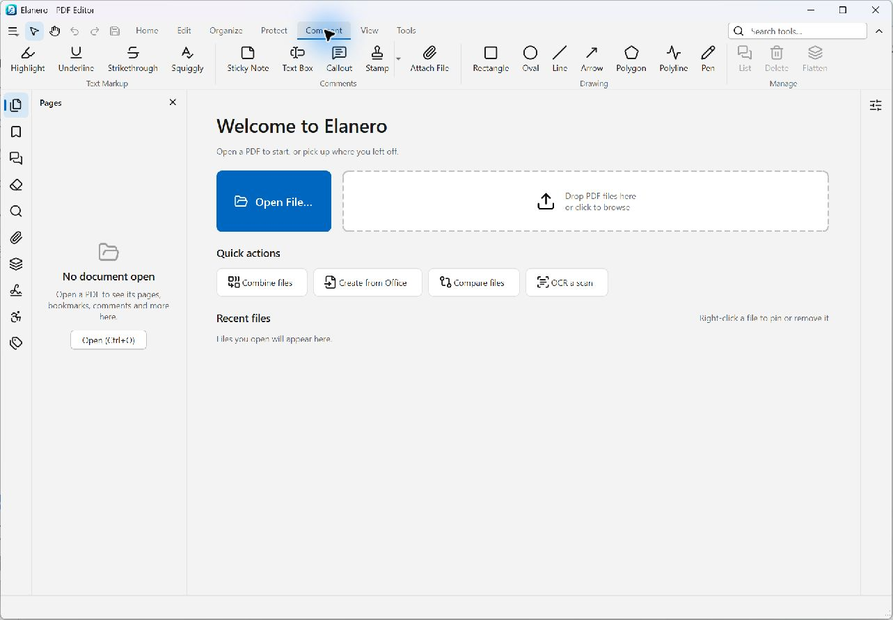

# Comments and review

Comments are marks that sit on top of the page: highlights, notes, stamps and drawings. They are
separate from the page content, so you can remove them without changing the text or pictures
underneath. The **Comment** ribbon tab holds all the review tools.

## Mark up text

Select the **Select Tool** (**V**), then drag across the text you want to mark, and use one of the
buttons in the **Text Markup** group:

- **Highlight** (**Edit ▸ Highlight**)
- **Underline**
- **Strikethrough**
- **Squiggly**, a wavy underline

The mini toolbar that appears beside a text selection offers the markup buttons too.

## Add notes and boxes

The **Comments** group:

- **Sticky Note** (**Ctrl+6**): click the page to place a note, then type in it.
- **Text Box**: drag a rectangle (or click for a default size) and type.
- **Callout**: a text box with a pointer to the spot it talks about.
- **Stamp**: choose a standard stamp such as **Approved**, **Draft**, **Confidential** or **Final**,
  or your own image. Choose **Add Custom Stamp…** to add a PNG or JPEG image as a stamp, and
  **Remove Custom Stamp** to delete one.
- **Attach File**: click a spot on the page and choose a file to attach to it.

## Draw

The **Drawing** group:

- **Rectangle**, **Oval**, **Line** and **Arrow**: drag from one corner (or end) to the other.
- **Polygon** and **Polyline**: click each corner or point, then double-click to finish.
- **Pen**: draw freehand. Strokes are smoothed when you release the mouse.

In the web version, the comment toolbar has Sticky Note, Text Box, Rectangle, Highlight, Oval,
Line, Arrow, Callout, Pen, Polygon and Polyline. A text box, like a sticky note, asks for its text
once you place it. A line or arrow is drawn by dragging from one end to the other; a click without
a drag adds nothing. A callout takes two steps: click its tip, then drag its box (or click for the
default size), then type its text. A pen draws a stroke while you drag. A polygon or polyline takes
a click for each corner and finishes on a double-click or Enter; a polygon also closes when you
click its first corner. Pen, polygon and polyline have no keyboard placement.

The Text Markup group (Highlight, Underline, Strikeout and Squiggly) marks the text you have
selected, one comment per page, as the desktop does. Press the button after selecting text, and the
markup is added at once; Undo removes it. With no text selected, Highlight turns on its drag tool
for a box (for a page with no text), and the other three ask you to select text first.

## Manage comments

The **Manage** group:

- **List** (**Comments List**, **Ctrl+Shift+C**) opens the **Comments** panel.
- **Delete** (**Delete Comment**) removes the selected comments.
- **Flatten** (**Flatten All Comments**) makes comments part of the page, so they can no longer be
  moved or edited. Use it when the review is finished and you want the marks to stay as they are.
  In the web version, Flatten asks you to confirm first. You can undo it until you save the file;
  after that, the flattening is permanent for that file.
  Form fields and signatures are never flattened. A signed document can be flattened, but its
  signatures will show that the pages changed after signing. After a flatten, a save over the
  original is refused, so save a copy instead; the copy keeps the signature fields.
- **Export Comments** saves the comments as XFDF (for another PDF editor), as a CSV summary, or as a
  PDF summary. The file is downloaded and the document is not changed. In the web version, the PDF
  summary is not available in every browser; the app tells you when it is not.
- **Import Comments** adds the comments from an XFDF file (for example, one exported from another PDF
  editor) to the document as one step, so **Undo** removes them all. In the web version, the file
  can be up to 8 MB; the dialog shows how many comments it holds before you import them.

Select a comment to move or resize it, and copy and paste it (**Ctrl+C** and **Ctrl+V**). The
**Properties** panel (**Ctrl+E**) changes the color, fill, opacity, border, text and author of the
selected comment, and can lock it.

!!! tip
    Set your name under **Preferences ▸ General ▸ Author name**. It is shown on the comments you add.

## The Comments panel

Open it from the **Comments** button in the left side panels, or click **List** in the **Manage** group of
the **Comment** tab (**Ctrl+Shift+C**).

- Every comment in the document is listed as a thread, with its page, type, author and status.
- Click a comment to go to it on the page.
- **Reply** opens a box under the thread. Type the reply and choose **Post reply** (Escape or
  **Cancel** closes the box without adding anything). The reply is signed with your name from the
  preferences.
- **Set status** marks the thread as Accepted, Rejected, Cancelled or Completed, for review
  workflows. Each reply and status change can be undone with the **Undo** button on its notice.
- **Edit** changes the text of a comment in place. Save the text, or press Escape to keep the old
  text. **Delete** removes the comment and its replies; press Delete or Backspace on a selected
  thread to do the same. Both can be undone. A locked comment cannot be edited or deleted until it
  is unlocked. Edit and Delete work on the thread's comment, not on its replies.
- Filter the list by type, author or status, or search it.
- Export comments as XFDF (for another PDF editor), as a CSV summary, or as a summary PDF. Import
  XFDF to bring in comments from another review.

## Limits

- Flattening keeps the marks visible but no longer editable. It doesn't remove them. To remove a
  mark, select it and use **Delete**.
