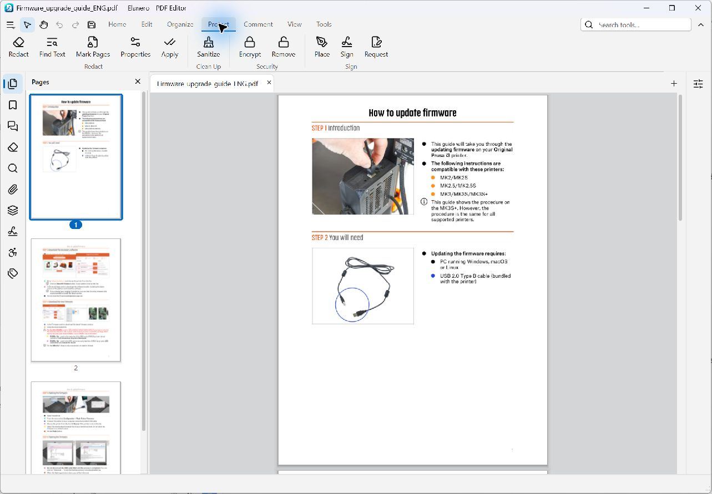

# Elanero User Guide

Elanero - PDF Editor is a free, open-source desktop app for Windows. It reads, searches, edits,
reviews, organizes, redacts, recognizes, converts and signs PDF files, all on your own computer.
There is no account, no subscription, no advertising and no telemetry. Downloads and an overview
are on the [Elanero website](https://linguagraph.github.io/elanero-pdf-editor/).

## Start here

- [Getting started](getting-started.md): install Elanero, open your first file.
- [Interface](interface.md): the ribbon, the menus, the side panels and the start page.

## Work with documents

- [Reading and navigation](reading.md): layouts, zoom, search, bookmarks, links and printing.
- [Editing text and images](editing.md): change existing content, add text, images and shapes.
- [Comments and review](comments.md): highlights, notes, stamps, drawings and the Comments panel.
- [Pages](pages.md): organize, insert, delete, extract and split pages, and combine files.
- [Redaction and security](security.md): permanently remove content, clean hidden data, and
  password-protect files.

## Tools

- [OCR and scanned documents](ocr.md): make scanned pages searchable.
- [Export and conversion](export.md): save as Word, Excel, text, images and more.
- [Optimize and compare](optimize-compare.md): make files smaller, see what takes space, and
  compare two versions.
- [PDF/A and accessibility](pdfa-accessibility.md): archival checks and accessibility checks.
- [Digital signatures](signing.md): sign with a certificate, request signatures, and check them.
- [Translation](translation.md): translate selected text with an online service.

## Settings and reference

- [Preferences](preferences.md): options, themes, the interface language and file association.
- [Keyboard shortcuts](keyboard-shortcuts.md): every command and its default shortcut.
- [Web version accessibility](web-accessibility.md): keyboard use, screen readers, high-contrast
  colours, reduced motion and touch targets in the web version.
- [Troubleshooting](troubleshooting.md): recovery copies, logs, known limits and bug reports.
- [Privacy](privacy.md): what Elanero stores and when it uses the internet.

## Help inside the app

Press **F1** or choose **Help ▸ Elanero Help** to open this guide. The **?** button at the right of
the ribbon, the link on the start page and the **Documentation** link in **Help ▸ About Elanero** open it
too. The guide opens in your web browser at <https://linguagraph.github.io/elanero-pdf-editor/guide/>.

!!! note "Which version this guide describes"
    The guide describes the latest release and any changes merged since. Where a feature is
    newer than the previous release, its page says so.
