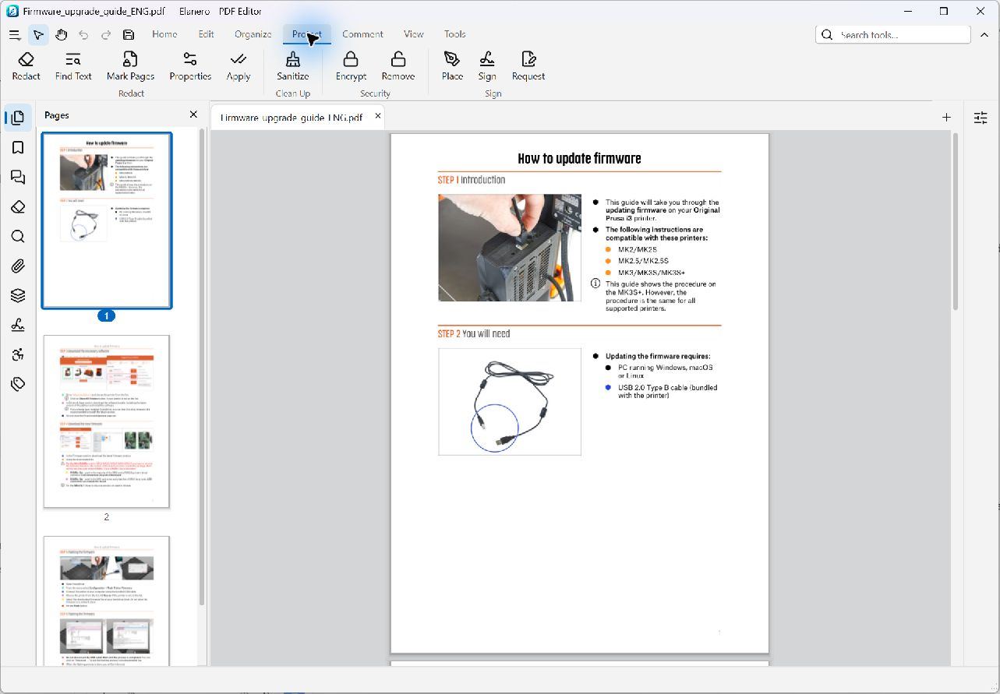

# Redaction and security

This page covers three jobs: **redacting** (permanently removing content), **sanitizing** (removing
hidden data), and **protecting** the file with passwords and permissions. They are on the
**Protect** ribbon tab.

## Redact: remove content for good

Redaction is permanent. It is not the same as covering text with a white box: a box can be moved
or removed, and the text stays in the file. Redaction removes the text and images under the marks
from the file.

1. **Mark** the content. Use one of these on the **Redact** group:
   - **Redact** (the first button): drag over the text or picture to mark it.
   - **Mark Pages**: mark whole pages.
   - **Find Text**: find words or patterns across the document and mark all of them. Choose a
     preset: email addresses, phone numbers, IBAN numbers, credit-card numbers (checked with the
     Luhn test), US Social Security numbers, dates, or your own regular expression or words. Select
     the matches you want, then choose **Mark Selected**.
2. **Review** the marks in the **Redactions** panel (left side) before you apply them.
3. Choose **Properties** to set the box color and the overlay text printed on each box (for example
   an exemption code).
4. Click **Apply** (**Apply Redactions…**) to remove everything under the marks. Choose all marks, or
   only the selected ones.

Elanero checks the result after applying, looking for leftover text and image data under the marks.
When you save, the file is written in full, so the removed content is not kept in earlier saved
versions of the file.

!!! warning "Check the saved file"
    To confirm a redaction worked, open the saved file in Elanero and search for a word you removed.
    Nothing should be found. Redaction removes content that Elanero can find; a scanned page needs
    [OCR](ocr.md) before a search can check it.

### Image and vector options

When you apply redactions, the **Apply Redactions** dialog asks what to do with pictures and drawings
under or touching a mark: remove an image that touches a mark, or blank only the covered pixels, and
remove or keep vector graphics. Choose the option that matches what the page shows.

## Sanitize: remove hidden data

**Sanitize Document…**, in the **Clean Up** group, removes data that people don't see but that can
travel with a file. Choose the categories to remove:

- Document properties (title, author and similar) and XMP metadata
- Comments and markups
- Embedded page thumbnails
- JavaScript and automatic actions
- Attached files
- Form field values
- Links
- Content on hidden layers
- Hidden (invisible) text and text outside the visible page area

Sanitizing changes the file, so save a copy first, with **Save As…**. A signed document can't be
sanitized: the change would invalidate its signatures, so the command refuses and the file stays as it was.

### In the web version

The web version has the same two jobs. On the document toolbar, use **Mark areas** and drag over the
areas to remove; the count shows the marks. **Clear marks** drops all the marks of the document,
including any already in the file, and **Apply redactions** asks you to confirm first. The
**Redactions** panel on the left rail lists the marks, lets you change each one's fill, text colour and
overlay text, and has **Apply Selected** and **Apply All**, which also ask you to confirm. **Sanitize document** opens a dialog with the same categories as above, which
you confirm before anything is removed. Both show their progress and can be cancelled, and Undo works
until you close the document. When the run finishes, the dialog lists what was removed and says to save
the document to write the cleaned file. A signed document is refused, as on the desktop, and a document
with a password cannot be redacted or sanitized in the browser: open it in the desktop app.

**Properties** (on the **Redact** group) sets the box colour, the text colour and the text on the box
for the marks you make from now on. The overlay text is limited to 64 characters. Properties works
with no document open and never changes a document: marks already drawn keep their style. The same
settings are the redaction box style in [Preferences](preferences.md).

## Encrypt with a password

**Encrypt with Password…** (in the **Security** group) protects the file. You can require a password to
open it, set a separate permissions password, or both.

- **Require a password to open the document**: needed to open the document at all. Enter it twice.
- **Restrict printing, editing and copying**: sets a permissions password, needed to change the
  restrictions later or to remove them. Without an open password, anyone can open the file, but the
  restrictions still apply.
- **Encryption**: **AES 256-bit** (Acrobat X and later) or **AES 128-bit** (Acrobat 7 and later).
  Choose AES 256-bit unless you must open the file in an older reader.
- **Allowed**: under **Permissions**, tick what readers may do: printing; copying text and images;
  changing the document; inserting, deleting and rotating pages; filling in forms; commenting.

The password is applied when you save. Elanero doesn't remember passwords, so keep them somewhere
safe: a file whose open password you lose can't be opened.

## Remove security

**Remove Security…** removes the passwords and restrictions from a file. For a file with a permissions
password, enter that password. Use it only on files you are allowed to change.

To check what protection a file has, open **File ▸ Document Properties…**, which also shows the
security information of the file.

### In the web version

The web version has the same two dialogs, **Encrypt with Password** and **Remove Security**, from the command palette. The change is applied when you save the document, and an Undo is offered after each change. The owner password is asked for only when the file needs it. The passwords you type are not written to the browser's storage.

The **Security** tab of **Document Properties** shows the security of the open file: the method, each permission as Allowed or Not allowed, whether the permissions password has been entered in this session, and any change waiting for the next save. The tab only reads the file. It has no password field; use the two dialogs above to change the security.

## Limits

- Redaction and sanitizing work on the content Elanero can read. Scanned pages need OCR first.
- Passwords protect a file from being opened or changed in a reader that respects them; they are not
  a substitute for keeping the file somewhere safe.
